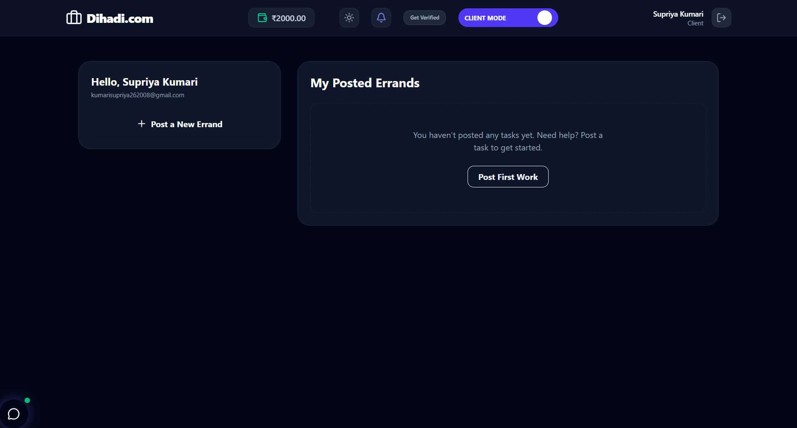
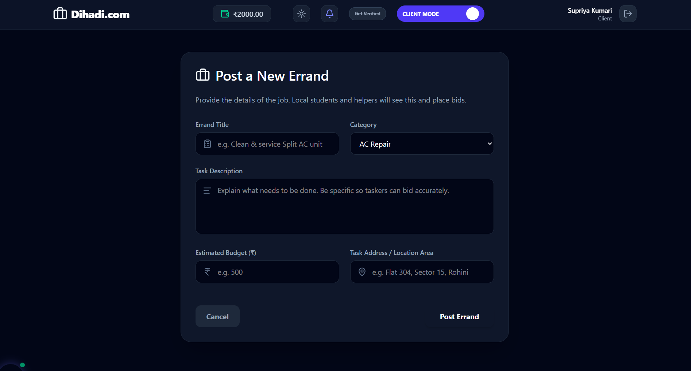

# Dihadi.com

A hyper-local errand marketplace and escrow-protected task platform connecting local clients with nearby earners.

## Description

Getting quick, practical help for everyday tasks—such as picking up medicines, delivering packages across town, home cleaning, or fixing electrical and AC issues—often leads to chaotic exchanges in unorganized social media groups, dealing with strangers without background checks, or arguing over cash payments without guarantees.

Dihadi.com solves this by introducing a transparent, escrow-backed workflow for hyper-local tasks. Clients post errands with their exact location, requirements, and budget. Nearby taskers explore opportunities on an interactive Leaflet map and place bids. Once a tasker is accepted, the client's payment is held securely in platform escrow, the earner shares live GPS location updates while on the move, and both parties communicate through real-time chat with photo proofs and voice notes. Payments are released only after the client approves the completed work, while an admin dispute queue protects both sides.

### Screenshots





## Getting Started

### Dependencies

* **Node.js:** v18.0.0 or higher (v20+ recommended)
* **npm:** v9.0.0 or higher
* **Operating System:** Windows, macOS, or Linux
* **Browser:** Any modern browser supporting Geolocation and Audio Recording (Chrome, Edge, Firefox, Brave)
* **Database:** Free [MongoDB Atlas](https://www.mongodb.com/atlas) cluster

### Installing

1. Clone the repository:
```bash
git clone https://github.com/Supriya-Kumari/Dihadi.com.git
cd Dihadi.com
```

2. Install backend dependencies:
```bash
cd backend
npm install
```

3. Install frontend dependencies:
```bash
cd ../frontend
npm install
```

4. Configure environment variables:
Create a `.env` file in the `backend/` directory:
```env
PORT=5000
MONGO_URI=your_mongodb_atlas_connection_string
JWT_SECRET=your_jwt_secret_key
```

### Executing program

1. Run the backend server:
```bash
cd backend
npm run dev
```

2. Run the frontend development server:
```bash
cd frontend
npm run dev
```

3. Open your browser and navigate to:
```text
http://localhost:5173
```

4. Build and run production build:
```bash
# Frontend
npm run build
npm run preview

# Backend
npm run build
npm start
```

## Help

* **Location Permission Not Prompting:** If the radius slider or errand locator does not detect your coordinates, verify that location access is allowed in your browser settings (`chrome://settings/content/location`) and that the site is served over `localhost` or HTTPS.
* **Microphone Access for Voice Notes:** If audio recording fails in the chat console, check browser permissions for microphone input. Reloading the page initializes the browser MediaRecorder API.
* **Database Connection Errors:** Ensure your current IP is whitelisted under Network Access in MongoDB Atlas (`0.0.0.0/0` for cloud deployment) and that the cluster is in an active (unpaused) state.

## License

This project is licensed under the MIT License - see the [LICENSE.md](LICENSE.md) file for details.
